<div align="center">

# UTH Environmental Widget

**ป้ายข้อมูลสิ่งแวดล้อมสำหรับโรงพยาบาลอุทัย**<br>
PM2.5 · สภาพอากาศ · ระดับน้ำสถานีอ้างอิง

[เปิด Widget หลัก](https://aase7en.github.io/webapp-widget/) · [ดูหน้า Weather](https://aase7en.github.io/webapp-widget/v2/weather-luxury.html) · [ดูหน้าระดับน้ำ](https://aase7en.github.io/webapp-widget/v2/water-luxury-live.html) · [หน้ารวมตัวอย่าง](https://aase7en.github.io/webapp-widget/v2/)

</div>

## โปรเจกต์นี้ทำอะไร

แสดงข้อมูลสิ่งแวดล้อมที่อ่านได้รวดเร็วบริเวณโรงพยาบาลอุทัย จังหวัดพระนครศรีอยุธยา บนแถบ LED **432 × 40 พิกเซล** ซึ่งใช้พื้นที่ส่วนหนึ่งของจอจริงขนาด 432 × 288 พิกเซล หน้าหลักสลับระหว่างฝุ่น สภาพอากาศ และระดับน้ำโดยอัตโนมัติ พร้อมภาพเคลื่อนไหวและภาพนิ่งสำรองสำหรับอุปกรณ์หรือการตั้งค่าที่ลดการเคลื่อนไหว

ข้อมูลที่แสดงเป็นข้อมูลประกอบการติดตามสถานการณ์ ไม่ใช่เครื่องมือวินิจฉัยหรือระบบแจ้งเตือนภัยฉุกเฉินโดยลำพัง ควรตรวจสอบเวลาและประกาศทางการประกอบเสมอ

| หน้า | แสดงอะไร | ที่มาของข้อมูล |
| --- | --- | --- |
| PM2.5 | ค่ารายชั่วโมง ระดับสี และกราฟย้อนหลังสูงสุด 24 ชั่วโมง | GISTDA ผ่าน Google Sheet |
| Weather | อุณหภูมิ ความรู้สึก ความชื้น โอกาสฝน ค่าสูงสุด/ต่ำสุด และพยากรณ์ 7 วัน | แบบจำลอง Open-Meteo ผ่าน Google Sheet |
| Water | สถานีอ้างอิง HDA004 ช่องสะเดา และ S.5 สะพานปรีดี พร้อมกราฟประวัติ | ThaiWater/HII ผ่าน Google Sheet |

> **ข้อจำกัดสำคัญ:** PM2.5 เป็นค่าประมาณระดับพื้นที่ ไม่ใช่เครื่องวัดหน้าโรงพยาบาล; อากาศเป็นผลแบบจำลอง; สถานีน้ำเป็นสถานีอ้างอิง ไม่ใช่เซนเซอร์ของโรงพยาบาล ภาพประตูน้ำเป็นภาพประกอบ ไม่ได้บอกสถานะประตูจริง
>
> โค้ด PM2.5 ปัจจุบันนำ **ค่ารายชั่วโมง** ไปเทียบช่วงสีที่แสดง ยังไม่ได้ใช้ค่าเฉลี่ย 24 ชั่วโมงเป็นตัวเปลี่ยนสีตามความต้องการเดิม จึงไม่ควรตีความสีนี้ว่าเป็นการจัดระดับจากค่าเฉลี่ย 24 ชั่วโมง งานแก้ไขยังต้องดำเนินการต่อ

## ตัวอย่างหน้าจอ

ภาพต่อไปนี้จับจากหน้าเว็บที่ขนาด 432 × 40 แล้วขยาย 3 เท่าให้อ่านง่าย **ค่าฝุ่น กราฟ ค่าพยากรณ์ และภาพสถานะน้ำในชุดสาธิตเป็นข้อมูลจำลองเพื่อแสดงรูปแบบเท่านั้น ไม่ใช่ข้อมูลปัจจุบัน** ส่วนภาพน้ำที่ระบุว่าเป็นภาพจริงบันทึก ณ วันที่ 31 ตุลาคม 2569 เวลา 08:45 น. ค่าอาจเปลี่ยนไปหรือเก่าแล้ว ให้เปิดลิงก์หน้าเว็บเพื่อตรวจข้อมูลล่าสุด ภาพนิ่งไม่แสดงการเคลื่อนไหวของ animation

### PM2.5 — ห้าระดับสี

| ฟ้า · ดีมาก | เขียว · ดี |
| --- | --- |
| 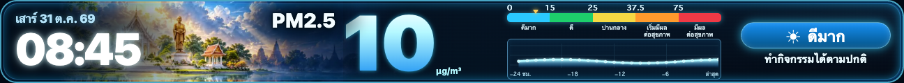 | 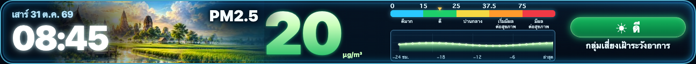 |
| **เหลือง · ปานกลาง** | **ส้ม · เริ่มมีผลต่อสุขภาพ** |
| 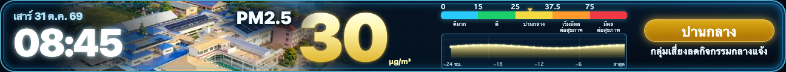 | 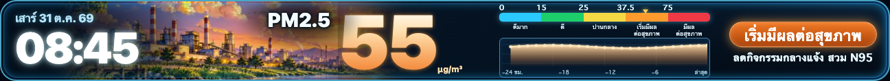 |
| **แดง · มีผลต่อสุขภาพ** | |
| 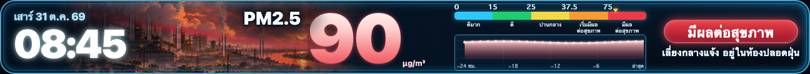 | |

### Weather — ไอคอนและฉากตามสภาพอากาศ

ค่าทุกภาพในส่วนนี้เป็น **ข้อมูลจำลอง** เพื่อแสดงสภาพอากาศและหน้าตาแต่ละแบบ

<details open><summary><strong>สภาพอากาศกลางวัน</strong></summary>

| แดดสลับเมฆ | เมฆมาก |
| --- | --- |
| 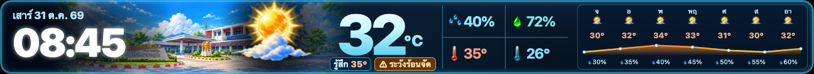 |  |
| **ฝน** | **พายุฝนฟ้าคะนอง** |
| 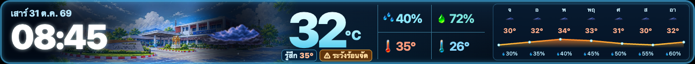 | 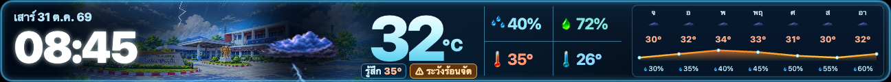 |
| **หมอก** | **ลมแรง** |
| 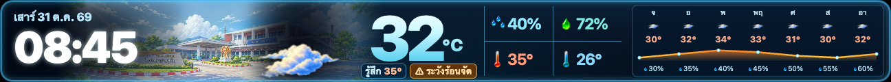 | 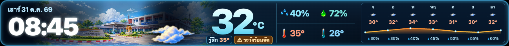 |

</details>

<details><summary><strong>สภาพอากาศกลางคืน — กดเพื่อดู</strong></summary>

| กลางคืน | ฝนกลางคืน |
| --- | --- |
| 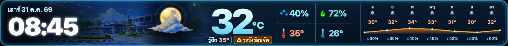 | 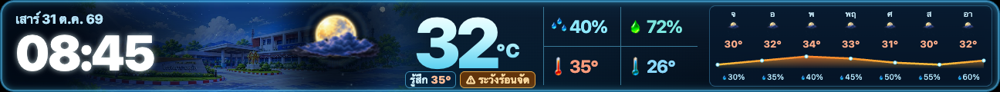 |
| **ลมแรงกลางคืน** | **พายุฝนฟ้าคะนองกลางคืน** |
| 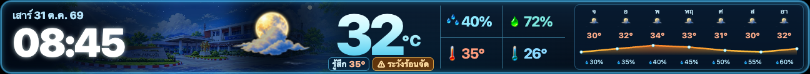 | 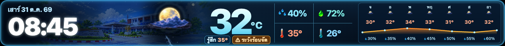 |

</details>

กราฟพยากรณ์ใช้สีฟ้า → เขียว → เหลือง → ส้ม → แดง เพื่อช่วยอ่านความแตกต่างของอุณหภูมิ **สีกราฟเป็นการออกแบบภาพ ไม่ใช่เกณฑ์เตือนสุขภาพอย่างเป็นทางการ**

### ระดับน้ำ — สถานีอ้างอิง

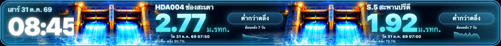

<details><summary><strong>ตัวอย่างสถานะน้ำ — ข้อมูลจำลอง กดเพื่อดู</strong></summary>

| ต่ำกว่าตลิ่ง | ถึงตลิ่ง |
| --- | --- |
| 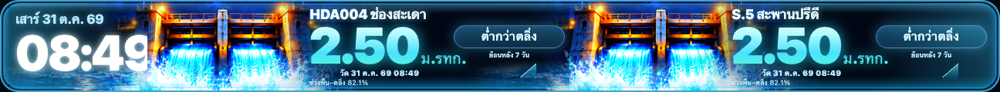 | 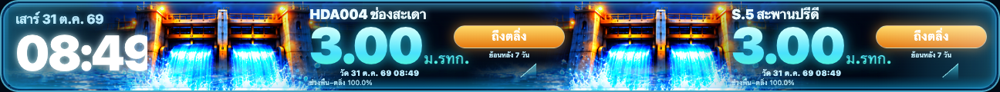 |
| **สูงกว่าตลิ่ง** | **ข้อมูลเก่า** |
| 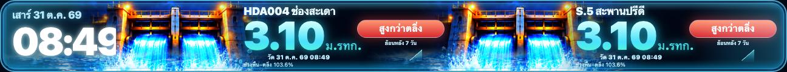 | 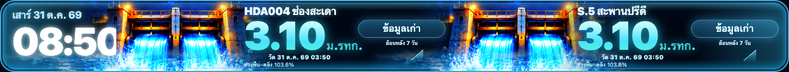 |
| **รอข้อมูล** | |
| 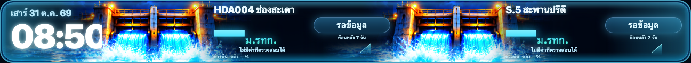 | |

</details>

ค่าที่ขาดหรือเก่าต้องพิจารณาตามเวลาวัดและสถานะบนหน้าจอ เทียบระดับกับตลิ่งเฉพาะเมื่อมีข้อมูลอ้างอิงที่ถูกต้อง ป้ายระดับน้ำไม่ใช่คำสั่งอพยพ

## แหล่งข้อมูลและเครดิต

ขอบคุณผู้ให้บริการข้อมูลและหน่วยงานที่เกี่ยวข้อง เครื่องหมายด้านล่างใช้เพื่อระบุแหล่งที่มา ไม่ได้แสดงการรับรองโครงการจากเจ้าของเครื่องหมาย

| ผู้ให้บริการ | บทบาทในระบบ | ข้อมูลและเงื่อนไข |
| --- | --- | --- |
| [](https://www.gistda.or.th/) | ค่า PM2.5 ประมาณรายชั่วโมงระดับตำบล | [เช็คฝุ่น GISTDA](https://pm25.gistda.or.th/) · [แหล่งโลโก้](https://www.gistda.or.th/about/download-gistda-logo-2/) |
| [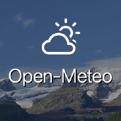](https://open-meteo.com/) | ข้อมูลและพยากรณ์อากาศแบบจำลอง รวมถึงข้อมูลแบบจำลองน้ำที่ backend ดึงไว้ | [Weather API](https://open-meteo.com/en/docs) · [Flood API](https://open-meteo.com/en/docs/flood-api) · ข้อมูล [CC BY 4.0](https://creativecommons.org/licenses/by/4.0/) · [เงื่อนไขบริการ](https://open-meteo.com/en/terms) |
| [](https://www.hii.or.th/) | ThaiWater/HII รวบรวมและให้บริการข้อมูลระดับน้ำจากสถานีอ้างอิง | [ThaiWater](https://www.thaiwater.net/) · [ข้อมูลหน่วยงานและเครื่องหมาย](https://www.hii.or.th/เครื่องหมาย-สสน/) |

โค้ดเดิมในโปรเจกต์ยังอ้างถึง [Air4Thai / กรมควบคุมมลพิษ](https://www.air4thai.com/) และ [World Air Quality Index (WAQI)](https://aqicn.org/) สำหรับงานเดิมบางส่วน แต่ **ไม่ใช่แหล่งหลักที่ยืนยันว่าป้อนสามหน้าหลักในปัจจุบัน** เครดิตและโลโก้แสดงไว้เพื่อให้เห็นที่มาของโค้ดเดิม:

[](https://www.pcd.go.th/)　[](https://aqicn.org/media/)

ภาพเครื่องหมายเป็นทรัพย์สินของเจ้าของแต่ละราย ดูที่มาไฟล์ได้ใน [รายการแหล่งโลโก้](docs/readme/brands/SOURCES.md) การใช้งานข้อมูลและ API ต้องเป็นไปตามเงื่อนไขของผู้ให้บริการแต่ละราย

## ระบบทำงานอย่างไร

```text
GISTDA ──────┐
Open-Meteo ──┼─→ Apps Script ของชีตเดิม ─→ Google Sheet / snapshot ─→ GitHub Pages ─→ จอ LED
ThaiWater ───┘
```

- ตัวเก็บข้อมูลถูกตั้งให้ทำงานรายชั่วโมงและมีตัวจำกัดการเรียกข้อมูลซ้ำในชั่วโมงเดียวกัน หน้าเว็บอ่าน snapshot จาก Apps Script/Sheet แทนการให้ทุกหน้าเว็บเรียกผู้ให้บริการโดยตรง การทำงานจริงขึ้นกับ trigger และความพร้อมของต้นทาง
- เวลาข้อมูลจากต้นทางและเวลาบันทึกเป็นคนละค่า ข้อมูลเก่าหรือข้อมูลที่ไม่มีต้องไม่ถูกแสดงเป็นข้อมูลสดหรือแทนด้วยศูนย์ กราฟจะเว้นช่องที่ไม่มีข้อมูลจริง
- ข้อมูล PM และ snapshot ที่ระบบใหม่เป็นเจ้าของมีนโยบายเก็บสูงสุด 90 วัน; snapshot พยากรณ์เก็บ 2 วัน แถวระดับน้ำที่ระบบใหม่เป็นเจ้าของและผ่านการตรวจรูปแบบมีนโยบาย 90 วัน ไม่ลบข้อมูลเก่าที่ระบุเจ้าของไม่ได้โดยอัตโนมัติ
- ใช้ Google Sheet และ Apps Script เดิมที่ผูกกันอยู่ ไม่สร้างฐานข้อมูลแยกสำหรับป้ายนี้
- ณ จุดตรวจวันที่ 31 ตุลาคม 2569 การดึงและบันทึกด้วยมือผ่านแล้ว แต่ **ยังรอหลักฐานรอบ trigger รายชั่วโมงอัตโนมัติหลังติดตั้ง** อย่าใช้เอกสารนี้แทนการตรวจสถานะปัจจุบัน

ตรวจเลข cache version ของแต่ละหน้าและขอบเขตการตรวจล่าสุดได้ที่ [บันทึกเวอร์ชัน](docs/readme/VERSIONS.md)

## สำหรับผู้พัฒนา

| เส้นทาง | หน้าที่ |
| --- | --- |
| `index.html`, `v2/index.html` | หน้าหลักและการสลับหน้าของป้าย |
| `v2/pm25-live.*`, `v2/weather-luxury.*`, `v2/water-luxury-live.*` | หน้าฝุ่น อากาศ และน้ำตามลำดับ |
| `v2/api-client.js`, `v2/live-widgets.js`, `v2/weather-snapshot.js` | อ่านและตรวจข้อมูลสำหรับหน้าเว็บ |
| `apps-script/BackendApi.gs`, `HourlySnapshot.gs`, `WaterHistory.gs` | backend, การเก็บ snapshot และประวัติน้ำ |
| `docs/readme/` | ภาพตัวอย่างและเครดิตเครื่องหมาย |

ทดสอบแบบ local จากโฟลเดอร์ repo:

```sh
python3 -m http.server 8000
node --test tests/weather-snapshot.test.cjs
```

เปิด `http://localhost:8000/` การรัน local ยังต้องเข้าถึง backend ที่ตั้งค่าไว้หากต้องการข้อมูลจริง ก่อนแก้ระบบจริงให้ตรวจ [AGENTS.md](AGENTS.md) และ [SESSION-HANDOFF.md](SESSION-HANDOFF.md) รวมถึงสถานะ deployment และ trigger ล่าสุด ห้ามนำ secrets ลง repo เอกสารเทคนิคเพิ่มเติม: [LED rotation](LED-ROTATION.md) · [Water LED](WATER-LED.md) · [README เดิม — เก็บไว้เป็นประวัติ ไม่ใช่สถานะปัจจุบัน](docs/archive/README-legacy-20261031.md)
