

# UTH[AI] Environmental LED Widget

**สถานการณ์สิ่งแวดล้อมที่อ่านง่ายภายในไม่กี่วินาที**
*Environmental intelligence for public-facing hospital displays*

**v1.0.1 · Three Panels · 432 × 40 LED · GitHub Pages**

[**เปิดเว็บไซต์จริง**](https://aase7en.github.io/webapp-widget/) · [PM2.5](https://aase7en.github.io/webapp-widget/v2/pm25-live.html) · [Weather](https://aase7en.github.io/webapp-widget/v2/weather-luxury.html) · [Water Level](https://aase7en.github.io/webapp-widget/v2/water-luxury-live.html)

[เริ่มต้นสำหรับนักพัฒนา](#เริ่มต้นสำหรับนักพัฒนา) · [Data Architecture](#data-architecture-และความถูกต้องของข้อมูล) · [Multi-Site Roadmap](docs/architecture/MULTI-SITE-ADOPTION-PLAN.md) · [Changelog](CHANGELOG.md)

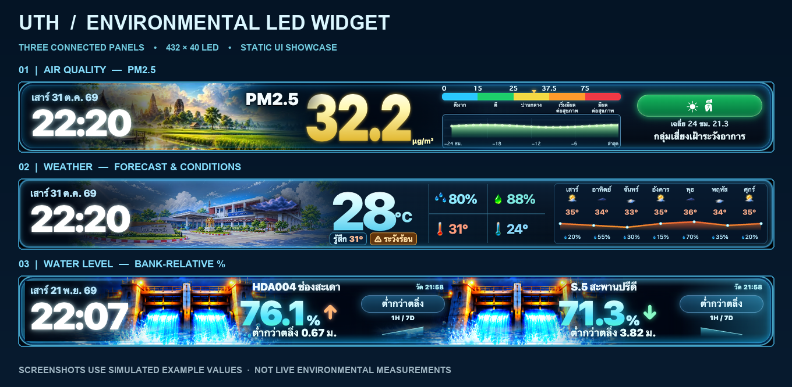

UI Showcase จากหน้าจอจริง · ค่าตัวเลขในภาพเป็น **SIMULATED / TEST DATA** ไม่ใช่สถานการณ์ปัจจุบัน และภาพนิ่งไม่แสดง Animation

---

## ภาพรวม

เว็บแสดงสถานการณ์สิ่งแวดล้อมสำหรับ **โรงพยาบาลอุทัย จังหวัดพระนครศรีอยุธยา** ออกแบบให้มองเห็นได้จากระยะไกลบนแถบ LED ความละเอียด **432 × 40 พิกเซล** (ภายในจอ 432 × 288) โดยหมุนเวียน 3 หน้าอัตโนมัติ มีกราฟตามเวลาจริง ภาพ 2.5D ประกอบ และสถานะข้อมูลเก่า/ไม่พร้อมที่แยกชัดเจน

| แผง | แสดงอะไร | Source of Truth |
| :--- | :--- | :--- |
| **PM2.5** | ค่ารายชั่วโมง, ค่าเฉลี่ย 24 ชั่วโมง, สถานะตามค่าเฉลี่ย และกราฟย้อนหลัง 24 ชั่วโมง | GISTDA เช็คฝุ่น ผ่าน Google Sheet |
| **Weather** | อุณหภูมิ, Feels Like, ความชื้น, โอกาสฝน, ต่ำสุด–สูงสุดและพยากรณ์ | Open-Meteo Model ผ่าน Google Sheet |
| **Water Level** | เปอร์เซ็นต์ช่วงพื้น–ตลิ่ง, ลูกศรแนวโน้มที่ยืนยันได้, เมตรถึงตลิ่ง และกราฟย้อนหลัง | ThaiWater/HII ผ่าน Google Sheet สถานี HDA004 และ S.5 |

**Release v1.0.1 ยังตั้งค่าสำหรับอุทัยเท่านั้น** แผนทำให้โรงพยาบาล/พื้นที่อื่นเลือก API และสถานีของตนเองได้อยู่ใน [Multi-Site Adoption Plan](docs/architecture/MULTI-SITE-ADOPTION-PLAN.md) ยังไม่ใช่ความสามารถที่เปิดใช้งานแล้ว

## Gallery · ทั้ง 3 หน้าของ Widget

ภาพตัวอย่างขนาด 3× ของแถบ LED เดิม (ค่าทั้งหมดเป็น **ข้อมูลจำลอง** ในการตรวจ UI)

### 01 — PM2.5 | Air Quality

[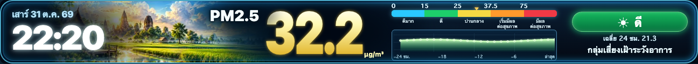](docs/readme/screenshots/pm25-green.png)

ตัวเลขใหญ่แสดงค่ารายชั่วโมง ส่วนสีสถานะและการสื่อสารด้านสุขภาพใช้ค่าเฉลี่ย 24 ชั่วโมงตามข้อมูลที่มีอยู่ การลงสีค่ารายชั่วโมงเป็นตัวช่วยอ่านค่า **ไม่ใช่เกณฑ์สุขภาพรายชั่วโมงอย่างเป็นทางการ**

<strong>เปิดดูตัวอย่างสีเพิ่มเติม</strong>

| ดีมาก | ดี | ปานกลาง |
| :--- | :--- | :--- |
| 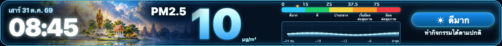 |  | 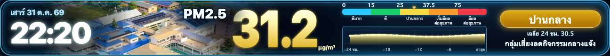 |

| เริ่มมีผลกระทบ | มีผลกระทบ |
| :--- | :--- |
| 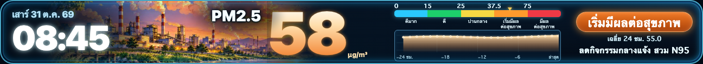 | 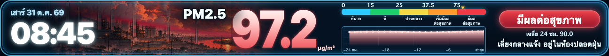 |

### 02 — Weather | Forecast & Conditions

[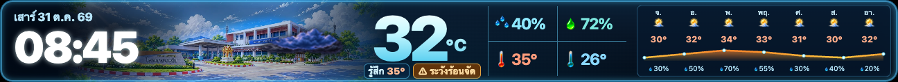](docs/readme/screenshots/weather-rain.png)

ฉากโรงพยาบาลและไอคอนสภาพอากาศแบบเคลื่อนไหว มี Poster สำรองและรองรับ Reduced Motion (ลดภาพเคลื่อนไหวตามการตั้งค่าระบบ)

<strong>เปิดดูตัวอย่างกลางวันและกลางคืน</strong>

| แดดสลับเมฆ | เมฆมาก | พายุฝน |
| :--- | :--- | :--- |
| 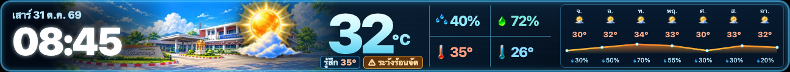 | 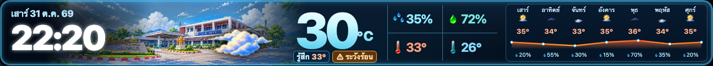 | 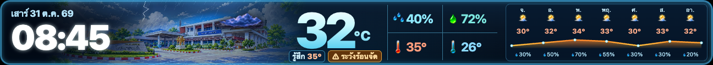 |
| หมอก | กลางคืน | ฝนกลางคืน |
| 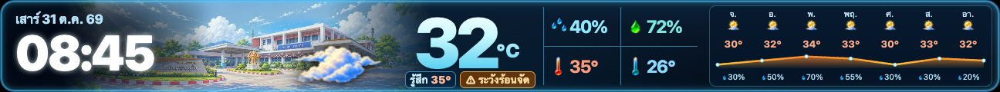 | 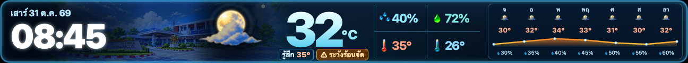 | 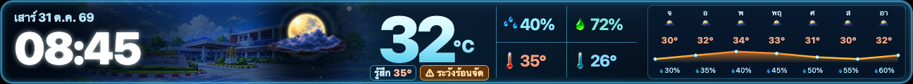 |

[ลมแรง](docs/readme/screenshots/weather-wind.png) · [ลมแรงกลางคืน](docs/readme/screenshots/weather-night-wind.png) · [พายุกลางคืน](docs/readme/screenshots/weather-night-thunderstorm.png)

### 03 — Water Level | Bank-Relative Water Level

[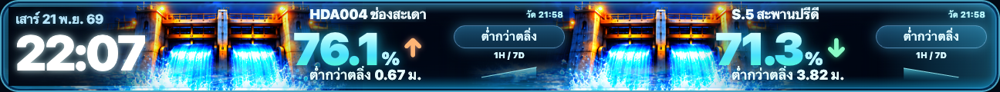](docs/readme/screenshots/water-percent-production-simulated.png)

คงภาพประตูน้ำ 2.5D, ฟองน้ำ, สีฟ้าเรืองแสง, กราฟย้อนหลังและนาฬิกาจากการออกแบบเดิม พร้อมแสดง **% ช่วงพื้น–ตลิ่งต่ำสุด** และ **ระยะห่างจากตลิ่ง (เมตร)**

**สูตร:** 100 × (ระดับน้ำ m MSL − ระดับพื้นอ้างอิง m MSL) ÷ (ตลิ่งต่ำสุด m MSL − ระดับพื้นอ้างอิง m MSL)

- ลูกศรขึ้น/ลงจะปรากฏเฉพาะเมื่อข้อมูลย้อนหลังมีเวลาตรวจวัดสัมพันธ์กับค่าล่าสุดและไม่ขัดแย้ง
- หากข้อมูลเก่า ไม่พร้อม หรือไม่สามารถคำนวณได้ จะแสดงค่าไม่พร้อมอย่างตรงไปตรงมา ไม่ใส่ศูนย์หรือคาดเดาแนวโน้ม
- **เปอร์เซ็นต์นี้ไม่ใช่โอกาสน้ำท่วม ความจุแม่น้ำ หรือเกณฑ์แจ้งเตือนภัยทางราชการ** และสถานี HII ไม่ใช่เซนเซอร์หน้าโรงพยาบาล
- ค่า m MSL เดิมและเวลาวัดยังอยู่ใน Accessible Metadata เพื่อช่วยเจ้าหน้าที่ตรวจสอบ

[ภาพจำลองกรณีสูงกว่าตลิ่ง](docs/readme/screenshots/water-percent-above-simulated.png) · [เปิด Water Level ที่ใช้งานจริง](https://aase7en.github.io/webapp-widget/v2/water-luxury-live.html)

## ความสดของข้อมูลวัด: 6 ชั่วโมง

สำหรับ PM2.5 และ Water Level ใช้ค่าที่ตรวจวัดได้ล่าสุดจาก Google Sheet เดิมตราบใดที่อายุจาก observedAt ไม่เกิน **6 ชั่วโมง**; หากไม่มีการตรวจวัดใหม่ระหว่างนั้นให้แสดงค่าเดิมพร้อมข้อมูลเวลาวัดจริง เมื่ออายุเกิน 6 ชั่วโมงให้แสดงตัวเลขใหญ่เป็น **—** และป้าย **ข้อมูลเก่าเกิน 6 ชม.** ไม่ใช้ศูนย์หรือเปลี่ยนเวลาตรวจวัดใหม่เอง

เมื่อ PM Snapshot ถูกตัวกรอง 3 ชั่วโมงเดิมของ Backend ปิดกั้น หน้าเว็บยังเรียกประวัติการวัดจริงจาก Sheet เดิมผ่าน pm25_history ได้เพื่อแสดงค่ารายชั่วโมงอายุ 3–6 ชั่วโมง แต่ไม่อนุมานค่าเฉลี่ย 24 ชั่วโมงหรือระดับสุขภาพโดยไม่มีหลักฐาน Weather เป็นข้อมูล Model มีเกณฑ์ความสดแยกต่างหากและยังใช้ 3 ชั่วโมง

## Data Architecture และความถูกต้องของข้อมูล

~~~text
GISTDA PM2.5 ───────┐
Open-Meteo Model ───┼──> Canonical Google Sheet "API Report_PM2.5"
ThaiWater / HII ────┘                   │
                                       ▼
                               Bound Apps Script
                                       │
                                       ▼
                         UthApiClient (read-only)
                                       │
                         PM2.5 / Weather / Water
                                       │
                              GitHub Pages / LED
~~~

**หลักการสำคัญ:** Observation Time (เวลาตรวจวัดจริง) ไม่ใช่ Fetch Time; Latest ไม่เท่ากับ Live; Historical (ข้อมูลเก่า), Simulated (ข้อมูลจำลอง) และ Unavailable (ไม่มีข้อมูล) ต้องไม่ถูกสื่อสารเป็นค่าปัจจุบัน

ข้อมูล PM2.5 เป็นตัวแทนเชิงพื้นที่ ไม่ใช่เครื่องวัดหน้าโรงพยาบาล; Weather ใช้แบบจำลอง; Water เป็นสถานีอ้างอิงภายนอก **ห้ามใช้ Widget เป็นเครื่องมือเตือนอุทกภัยหรือสั่งอพยพโดยลำพัง**

## เริ่มต้นสำหรับนักพัฒนา

โครงการเป็น Static Web App บน GitHub Pages สามารถเปิดเว็บจาก Local HTTP Server ได้โดยไม่ต้องสร้าง Backend เพิ่ม

~~~bash
git clone https://github.com/aase7en/webapp-widget.git
cd webapp-widget
python3 -m http.server 8000
~~~

เปิด http://localhost:8000/ หรือ http://localhost:8000/v2/ สำหรับหน้าจอหลัก Backend ข้อมูลจริงยังผูกกับ Sheet/Apps Script ของโรงพยาบาลอุทัย จึง **ไม่ควรนำ API Key หรือข้อมูลส่วนบุคคลมาใส่ใน Frontend**

ตรวจ Regression Tests:

~~~bash
node --test tests/*.test.cjs
node --check v2/water-luxury-live.js
~~~

การทดสอบ Chrome ของหน้า Water ใช้ Puppeteer ที่ติดตั้งบนเครื่องทดสอบและ **ใช้ Mock Data โดยไม่เรียก Provider จริง**: scripts/qa-water-public-percent-20261121.cjs

## Version · Release · Documentation

- **Product Release:** [v1.0.1](CHANGELOG.md) (Semantic Versioning เริ่มต้นสำหรับโครงการอุทัย)
- **Deployment:** Branch main → GitHub Pages; Asset Cache Keys แยกจาก Product Version
- **Version/Cache Matrix:** [docs/readme/VERSIONS.md](docs/readme/VERSIONS.md)
- **Technical Decision / Agent:** [AGENTS.md](AGENTS.md) · [SESSION-HANDOFF.md](SESSION-HANDOFF.md) · [Design System](docs/DESIGN-SYSTEM.md)
- **Release / Defect History:** [CHANGELOG.md](CHANGELOG.md) · [LED UX Defect Memory](docs/defects/LED-UX-DEFECT-MEMORY.md)

## Roadmap · สำหรับโรงพยาบาลและพื้นที่อื่น

**Planned, not implemented in v1.0.0.** ออกแบบ Site Profile (การตั้งค่าพื้นที่) และ Provider Adapter (ตัวเชื่อม API) เพื่อเปลี่ยนพิกัด ชื่อสถานี ที่มาของข้อมูล เวลา หน่วยและธีมได้อย่างปลอดภัย โดยไม่ต้องคัดลอก UI ไปแก้หลายชุด

[**Multi-Site Adoption Plan →**](docs/architecture/MULTI-SITE-ADOPTION-PLAN.md)

> **เรื่องสิทธิ์:** ณ รุ่นที่ตรวจสอบ Repository ยังไม่มีไฟล์ LICENSE ที่ระบุสิทธิ์ซอฟต์แวร์อย่างชัดเจน และภาพ/โลโก้/ข้อมูลบางส่วนอาจอยู่ภายใต้เงื่อนไขของผู้ให้บริการ ต้องตัดสินใจเรื่อง License และสิทธิ์ของ Assets ก่อนแจกจ่ายให้พื้นที่อื่นใช้ซ้ำ

## Data Credit / Attribution

- [GISTDA — เช็คฝุ่น](https://pm25.gistda.or.th/)
- [Open-Meteo](https://open-meteo.com/) · [Terms of Service](https://open-meteo.com/en/terms)
- [ThaiWater](https://www.thaiwater.net/) / [HII](https://www.hii.or.th/)

การอ้างอิงชื่อหรือโลโก้ไม่ใช่การรับรองโครงการจากเจ้าของข้อมูล

**UTH[AI] Environmental LED Widget — Clear data. Honest status. Reusable architecture in progress.**

[Production](https://aase7en.github.io/webapp-widget/) · [Issues](https://github.com/aase7en/webapp-widget/issues) · [Changelog](CHANGELOG.md)

