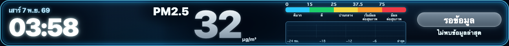
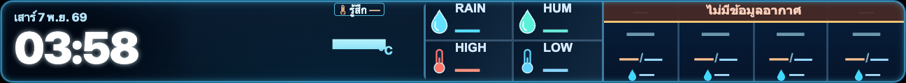
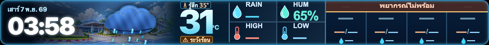
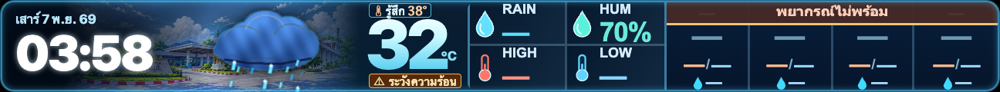
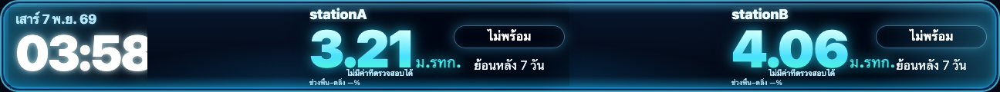

# LED 432×40 — Aligned Typography + Weather Badges visual review

**SIMULATED VISUAL FIXTURES ONLY. NO REAL WEATHER, PM2.5 OR WATER MEASUREMENTS.**
These PNGs are generated locally from the actual production DOM/CSS with all
remote API traffic blocked. Clock, values and warning states are QA fixtures.
The owner-approved typography reference remains the 2026-11-06 Aligned variant.

| Screen | After candidate (at native 432×40 CSS px) |
|---|---|
| PM2.5 |  |
| Weather + heat alert |  |
| Weather + mild heat |  |
| Weather + long warning |  |
| Water two stations |  |

Also verified: `weather-negative-432x40.png`, `weather-triple-digit-432x40.png`,
`weather-unavailable-432x40.png`, `weather-historical-432x40.png`,
`weather-reduced-motion-432x40.png`, `weather-mobile-390.png`.

- Browser geometry and scenario state: [browser-qa.json](./browser-qa.json).
- Reproducer: `node scripts/qa-led-aligned-20261107.cjs` (Puppeteer + Chrome).
- Browser checks: separate badge y-safe-zones, no overlap, °C before forecast panel,
  original clock untouched, correct visible/non-visible warning behavior,
  full long-warning text in `aria-label`/`title`, historical/unavailable,
  reduced-motion poster, mobile 390 and two Water stations.
- The current Weather production heat-index warnings remain unchanged:
  `ระวังร้อน` / `ระวังร้อนจัด`; the synthetic longer message is ONLY to
  exercise the compact-display fallback, not a new warning policy.
- Real hardware distance readability and iPhone Safari remain UNVERIFIED.
